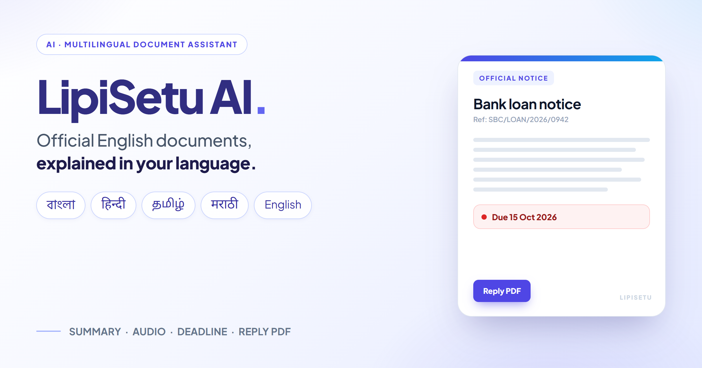
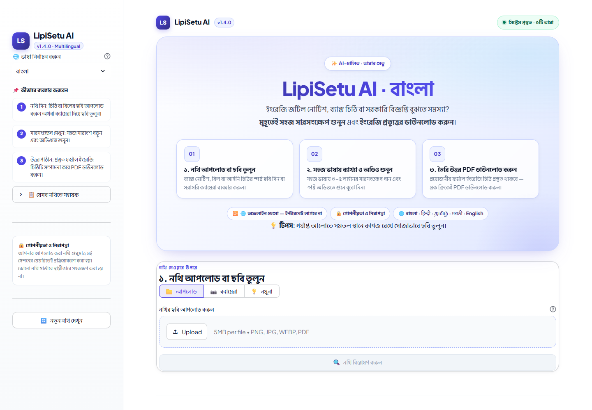
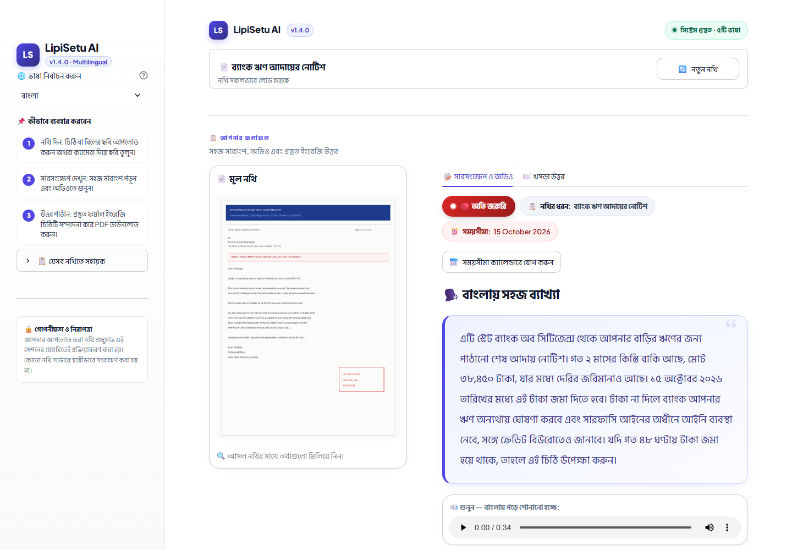
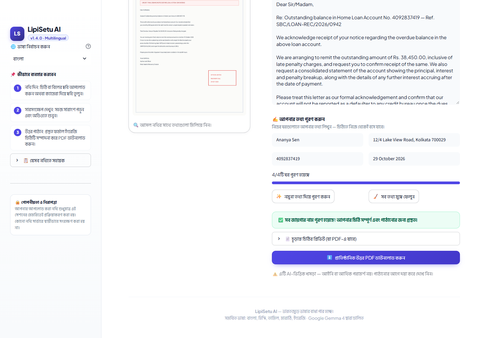
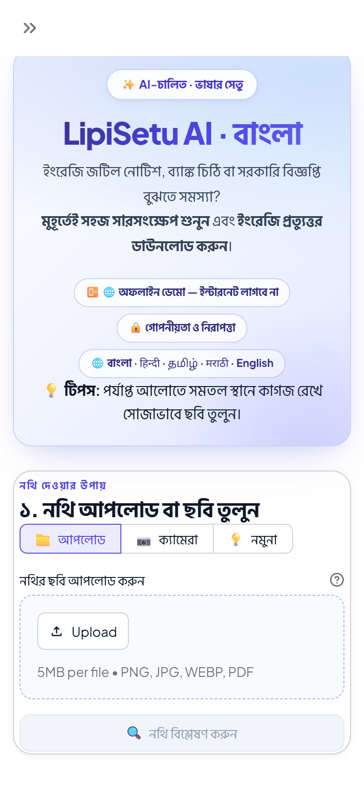
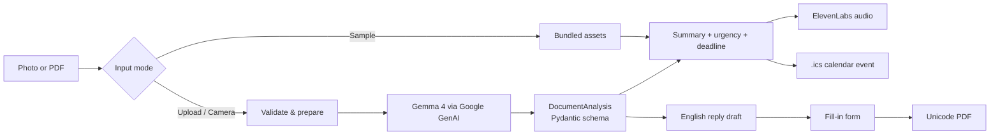

# 🌉 LipiSetu AI

<p align="center">
  
</p>

> **A photo of an official English notice goes in. A plain-language summary, spoken audio, a deadline you can add to your calendar, and a ready-to-send English reply come out.**

LipiSetu AI is a Streamlit app for people who receive official documents in English but live in Bengali, Hindi, Tamil, or Marathi. It reads the document, explains what is being asked, flags the urgency, reads the summary aloud, and drafts the formal English reply — already filled in and downloadable as a PDF. English is also available as a fifth interface-and-output language so recruiters, reviewers, and engineers can test the full flow without knowing an Indian language.

[](https://www.python.org/)
[](https://streamlit.io/)
[](#-testing)
[](https://github.com/captain-07/Lipi-Setu/actions/workflows/ci.yml)
[](LICENSE)

---

## ✨ What it does

| Step | What happens |
| --- | --- |
| **1. Give it a document** | Upload a photo **or a PDF**, take a camera snapshot, or load one of the bundled sample notices. |
| **2. Understand it** | Get a 3–5 sentence summary in simple spoken Bengali, Hindi, Tamil, Marathi, or English, plus a colour-coded urgency level and the printed deadline. |
| **3. Act on it** | Listen to the summary, add the deadline to your calendar, fill in a few details, and download a formal English reply as a PDF. |

The whole interface — labels, hero, workflow, errors, and validation messages — is translated. The app does not just translate the document; it tells you **whether you are the person being addressed and what happens if you ignore it**.

---

## 📸 Screenshots

| Home | Analysis |
| :---: | :---: |
|  |  |
| **Reply composer** | **Mobile** |
|  |  |

---

## 🚀 Try it in 30 seconds (no API keys, no internet)

```bash
git clone https://github.com/captain-07/Lipi-Setu.git
cd Lipi-Setu
python -m venv venv

# Windows
venv\Scripts\activate
# macOS / Linux
source venv/bin/activate

pip install -r requirements.txt
streamlit run app.py
```

Open **http://localhost:8501**, choose the **sample** mode (💡), pick a notice, and click the **analyze** button (🔍).

Sample mode replays pre-bundled analyses and audio. It never calls Google or ElevenLabs, so it works on a plane, in a classroom, or on a venue Wi-Fi that has just died. This was the single most useful decision made during the hackathon build.

---

## 🧩 Features

| Feature | Details |
| --- | --- |
| 🌐 **Five languages** | Bengali (বাংলা), Hindi (हिन्दी), Tamil (தமிழ்), Marathi (मराठी), and English — full UI and output. English is included for reviewers; the four Indian languages remain the primary experience. |
| 📄 **Images and PDFs** | JPG, PNG, WEBP, and PDF. Multi-page PDFs are read natively by Gemini |
| 🗣️ **Simple summary** | 3–5 short sentences, plain text, written for someone with basic schooling |
| 🔊 **Read-aloud audio** | ElevenLabs `eleven_multilingual_v2`, which detects the script from the text |
| 🔴🟠🟢 **Urgency + deadline** | Extracts the printed deadline and flags penalties, disconnection, or legal action |
| 📅 **Calendar export** | One click downloads an all-day `.ics` event with a two-day reminder |
| ✍️ **Fill-in-the-blanks reply** | Every `[PLACEHOLDER]`, including `[Reference No.]` and Indic-script tokens, becomes its own field |
| 📥 **Unicode PDF output** | Embedded Noto fonts render Bengali, Devanagari, and Tamil names correctly — no more `?` |
| 🔁 **Language switching** | Change language without losing the current result; one click re-analyzes in the new language |
| 🧭 **Result-first layout** | After analysis, the input card becomes a compact document bar so the summary and reply are immediately visible |
| 📴 **True offline demo** | Bundled analyses, audio, and self-hosted fonts — no network calls at all |
| 📷 **Camera support** | Take a photo directly; EXIF rotation is handled automatically |
| 🔒 **Privacy-first** | Documents are processed in memory and never written to disk by the app |
| ♿ **UI details** | Responsive layout, keyboard focus styles, reduced-motion support, copyable reply preview |

---

## 🏗️ How it works



The model returns a validated `DocumentAnalysis` object:

```python
class DocumentAnalysis(BaseModel):
    is_readable: bool
    quality_issue: str | None
    document_type: str  # short English label for the PDF subject
    document_type_local: str  # label in the reader's language, for the UI
    urgency_level: Literal["High", "Medium", "Low"]
    key_deadline: str | None
    local_summary: str
    english_summary: str
    official_english_reply: str
```

The English label and the localized label are kept separate so the letter's
subject line and filename stay in English while the interface speaks the
reader's language.

The reply contains `[PLACEHOLDER]` tokens. The app turns each distinct token into an input field, substitutes values case-insensitively, and keeps blank fields visible instead of silently deleting them. Indices are never used as widget keys, so editing the letter cannot shuffle answers into the wrong field.

---

## 🛠️ Tech stack

| Piece | Choice | Why |
| --- | --- | --- |
| UI | [Streamlit](https://streamlit.io/) | Fastest path to a usable, accessible data app |
| Vision + reasoning | **Gemma 4** (`gemma-4-26b-a4b-it`) via the [Google GenAI SDK](https://ai.google.dev/) | Strong document understanding with structured output |
| Speech | [ElevenLabs](https://elevenlabs.io/) `eleven_multilingual_v2` | One voice covers every supported language |
| PDF | [fpdf2](https://github.com/py-pdf/fpdf2) + `uharfbuzz` | Fast PDF creation with correct Indic shaping |
| Imaging | [Pillow](https://python-pillow.org/) | Validation, EXIF rotation, downscaling |
| Validation | [Pydantic](https://docs.pydantic.dev/) | A strict contract between model and UI |

---

## 🔑 Configuration

You only need keys for **upload** and **camera** modes. The offline demo works without them.

### Option A — environment variables

Set the variables directly:

```bash
# Windows PowerShell
$env:GEMINI_API_KEY="your-google-ai-key"
$env:ELEVEN_LABS_API_KEY="your-elevenlabs-key"

# macOS / Linux
export GEMINI_API_KEY="your-google-ai-key"
export ELEVEN_LABS_API_KEY="your-elevenlabs-key"
```

### Option B — Streamlit secrets (recommended for deployment)

Create `.streamlit/secrets.toml`:

```toml
GEMINI_API_KEY = "your-google-ai-key"
ELEVEN_LABS_API_KEY = "your-elevenlabs-key"

# Optional: use a different ElevenLabs voice
# ELEVENLABS_VOICE_ID = "21m00T4TlvDq8ikWAM"
```

The app accepts `ELEVEN_LABS_API_KEY`, `ELEVENLABS_API_KEY`, or `ELEVEN_API_KEY`, so existing setups keep working.

| Key | Required | Used for |
| --- | --- | --- |
| `GEMINI_API_KEY` | Upload / camera | Reading the document |
| `ELEVEN_LABS_API_KEY` | Upload / camera | Generating audio |
| `ELEVENLABS_VOICE_ID` | Optional | Choosing a different voice |

> Without an ElevenLabs key, analysis still works and the UI shows a friendly "audio unavailable" message. Audio is treated as an enhancement, not a blocker.

---

## 🖼️ Using the app

1. Pick your language in the sidebar. Your choice persists for the session.
2. Choose **Upload** (📁), **Camera** (📷), or **Sample** (💡).
3. Add your document and click the **analyze** button (🔍).
4. On the **Summary** tab:
   - Read the plain-language summary.
   - Listen to the audio.
   - Check the urgency badge, document type, and deadline.
   - Add the deadline to your calendar.
   - Open the English summary if you want to verify details.
5. On the **Reply** tab:
   - Edit the formal English letter if needed.
   - Fill in each `[PLACEHOLDER]` field.
   - Watch the completion banner turn green.
   - Preview and copy the final letter.
   - Download the filled PDF.
6. Change the language in the sidebar at any time. The current result stays visible; click the re-analyze button to get a summary in the new language.

### Supported inputs

| Limit | Value |
| --- | --- |
| Formats | JPG, PNG, WEBP, PDF |
| Maximum file size | 5 MB |
| Minimum image resolution | 400 px on the shorter side |
| Maximum image resolution | 1600 px (larger images are downscaled) |

PDFs are passed to Gemini natively, so multi-page bills and notices work without stitching pages together. Photos are auto-rotated using EXIF data.

### PDF output

The reply PDF embeds **Noto Sans**, **Noto Sans Bengali**, **Noto Sans Devanagari**, and **Noto Sans Tamil** with HarfBuzz shaping. Indic names and addresses render correctly. If the font files are missing, the app falls back to the core PDF font and shows a warning about Latin-1 values.

---

## 🌐 Supported languages

| Language | Code | UI font |
| --- | --- | --- |
| Bengali (বাংলা) | `bn` | Hind Siliguri |
| Hindi (हिन्दी) | `hi` | Noto Sans Devanagari |
| Tamil (தமிழ்) | `ta` | Noto Sans Tamil |
| Marathi (मराठी) | `mr` | Noto Sans Devanagari |
| English | `en` | Plus Jakarta Sans |

All UI strings live in `SUPPORTED_LANGUAGES` in `app.py`. Every language must define the same keys; a test enforces this. To add a language, copy an existing block, translate every value, add the language to the demo analyses and audio, and add WOFF2/TTF fonts for its script. See [CONTRIBUTING.md](CONTRIBUTING.md) for the full checklist.

---

## 📴 Offline demo mode

**Sample mode** never reaches the network. It replays:

| Path | Contents |
| --- | --- |
| `samples/demo_analyses.json` | 3 sample notices × 5 languages = 15 written analyses |
| `samples/audio/*.mp3` | 15 pre-generated speech files (~7 MB) |
| `static/fonts/*.woff2` | Self-hosted UI fonts, served by Streamlit |
| `assets/fonts/*.ttf` | Unicode fonts used by the PDF generator |

Regenerate the demo audio after editing `samples/demo_analyses.json`:

```bash
python scripts/generate_demo_audio.py            # only missing files
python scripts/generate_demo_audio.py --force    # regenerate everything
```

---

## 🔒 Privacy

- **Nothing is written to disk by the app.** Images and PDFs are processed in memory and discarded after the session.
- **No document content is logged.**
- In **upload** and **camera** modes, the document is sent to Google's Gemini API, and the summary text is sent to ElevenLabs for speech synthesis.
- **Sample mode sends nothing anywhere.**
- API keys are read from environment variables or Streamlit secrets; they are never rendered in the UI.

---

## 🧪 Testing

The project ships with a pytest suite that runs **without API keys and without network access**:

```bash
pip install -r requirements-dev.txt
pytest
ruff check .
ruff format --check .
```

Coverage includes:

- Translation key parity and format-string safety
- Placeholder extraction, including punctuated and Indic-script tokens
- Demo asset integrity (all 15 analyses validate, all audio files exist)
- Image and PDF validation limits
- Unicode PDF output and font embedding
- Deadline parsing and `.ics` generation
- An end-to-end headless `AppTest` of the offline demo, including prefill and language switching

The same checks run in GitHub Actions on Python 3.10 and 3.12. See
[`.github/workflows/ci.yml`](.github/workflows/ci.yml).

---

## 📁 Project structure

```text
LipiSetu/
├── app.py                     # UI, analysis pipeline, i18n, PDF, calendar
├── assets/
│   ├── styles.css             # Design system and responsive rules
│   └── fonts/                 # TTF fonts embedded in PDFs
├── static/fonts/              # WOFF2 fonts served to the browser
├── samples/
│   ├── demo_analyses.json     # Offline demo analyses
│   └── audio/                 # Offline demo speech
├── scripts/
│   ├── generate_demo_audio.py # Regenerate demo MP3s
│   └── generate_cover.py      # Rebuild docs/cover.png in a real browser
├── docs/                      # Cover and README screenshots
├── tests/                     # pytest + Streamlit AppTest suite
├── .streamlit/config.toml     # Theme, upload limit, static serving
├── .github/workflows/ci.yml   # Lint, format, and test on every push
├── requirements.txt
├── requirements-dev.txt
├── pyproject.toml
├── CONTRIBUTING.md
├── LICENSE
└── README.md
```

---

## ☁️ Deployment

### Streamlit Community Cloud

1. Push the repository to GitHub.
2. Create a new app pointing at `app.py`.
3. Add `GEMINI_API_KEY` and `ELEVEN_LABS_API_KEY` in the app's **Secrets** settings.
4. Deploy.

Static font serving is enabled in `.streamlit/config.toml`, so the UI fonts work in the cloud too.

---

## ⚠️ Limitations

These are deliberate and documented rather than hidden:

- **One document at a time.** A multi-page PDF works, but separate loose images must be combined into a PDF first.
- **Urgency is model judgment, not a rules engine.** It errs toward flagging.
- **OCR quality caps everything.** Below 400 px on the shorter side, text is genuinely illegible, so the app rejects the image instead of guessing.
- **Audio depends on ElevenLabs.** If the key is missing or the quota is exhausted, the app degrades to text.
- **The reply is a draft, not legal or financial advice.** The PDF footer says so too.
- **No authentication or rate limiting per user.** This is a demo, not a multi-tenant service.

---

## 🗺️ Roadmap

- Multi-image upload with automatic page ordering
- More languages (Telugu, Kannada, Gujarati, Odia)
- Optional "explain like I'm 10" and "detailed" summary tones
- Highlighted source passages for each urgency claim
- Offline OCR fallback for air-gapped deployments

---

## 📄 License

MIT — see [LICENSE](LICENSE).

---

Built with ❤️ for Indian language speakers.
**🌉 LipiSetu AI — The Bridge of Letters**
